# pfSense Firewall Lab | Routing, NAT, Firewall Rules & Intrusion Detection

[](https://www.pfsense.org/)
[](https://www.virtualbox.org/)
[](https://www.snort.org/)
[](https://www.kali.org/)

**Project type:** Controlled cybersecurity home-lab exercise  
**Author:** Alexander Cox  
**Source evidence:** `Cyber Home Lab Doc 1.docx` — original embedded images 49–75 and 81  
**Scope:** pfSense gateway configuration, firewall policy, NAT/SSH access, package-based Snort detection, rule validation, and blocking views.

## Objective

Deploy **pfSense** inside Oracle VirtualBox and use it as a lab firewall/gateway between virtual networks. Configure and examine interface addressing, create LAN filtering rules, test controlled **NAT port forwarding** to an internal vulnerable host, and deploy **Snort inside pfSense** to write and validate custom network-detection rules.

The project demonstrates both **network access control** (firewall/NAT) and **network visibility** (Snort alerts), while distinguishing detected traffic from traffic that was blocked. It does not claim that a full production architecture or all possible controls were validated.

## Skills demonstrated

- Virtual network planning and inspection using VirtualBox network adapters.
- Assigning pfSense WAN and LAN interfaces and interpreting DHCP versus static addresses.
- Discovering Linux IP addresses with `ip address` and using ICMP for troubleshooting.
- Configuring and reviewing ordered LAN firewall rules.
- Creating and validating destination NAT / port forwarding in an isolated lab.
- Testing an SSH connection using PuTTY through a translated destination.
- Installing and configuring the pfSense Snort package.
- Writing custom ICMP and SSH detection rules, reading SIDs, and analyzing alert logs.
- Reviewing blocking settings, blocked-host entries, and IP aliases with appropriate caution.

## Tools

| Tool | Function in this project |
|---|---|
| [pfSense](https://docs.netgate.com/pfsense/en/latest/) | Routing, interface management, stateful firewall, NAT, management GUI |
| [Oracle VirtualBox](https://www.virtualbox.org/) | Runs the pfSense and client/test VMs and their virtual adapters |
| [Kali Linux](https://www.kali.org/) | Network addressing and connectivity inspection |
| Metasploitable 2 | Intentionally vulnerable destination for isolated access testing |
| [PuTTY](https://www.putty.org/) | SSH session testing from a Windows host |
| [Snort](https://www.snort.org/) | Rule-based traffic detection as an add-on package inside pfSense |
| Windows Command Prompt | ICMP connectivity tests to the pfSense WAN address |

## Lab topology — based on observed addresses

The relevant screenshots show **two IPv4 networks** and two pfSense interfaces. The diagram below is a logical interpretation of the addresses and NAT test; it does **not** imply that all later screenshots were recorded at the same moment.

```text
                 VirtualBox / physical host-side LAN
                      192.168.100.0/24
                               |
          +--------------------+--------------------+
          |                    |                    |
     Windows / PuTTY      Kali Linux eth0      pfSense WAN (em0)
       test client        192.168.100.207      192.168.100.245
          |                                          |
          +-- SSH to 192.168.100.245:22 --> [NAT]   |
                                                     |
                                            pfSense LAN (em1)
                                              172.30.2.1/24
                                                     |
                                           internal pfVulnlab1
                                              172.30.2.0/24
                                                     |
                                   +-----------------+----------------+
                                   |                                  |
                              Kali Linux eth1                Metasploitable 2
                               172.30.2.100                     172.30.2.102
                                                                      ^
                                                                      |
                                              WAN port forward targets this IP

                     Snort package monitors pfSense LAN traffic
```

**Important:** The screenshot of the extra `OPT1` rule near the end shows a **different subnet** (`172.60.1.0/24`) in a separate lab configuration. It is documented independently rather than falsely inserted into this specific 172.30.2.0/24 layout.

| Component | Address / interface | Evidence |
|---|---|---|
| pfSense WAN | `em0`, DHCP `192.168.100.245/24` | pfSense console screenshot |
| pfSense LAN | `em1`, `172.30.2.1/24` | pfSense console screenshot |
| Kali Linux external-facing interface | `eth0`, `192.168.100.207/24` | `ip address` output |
| Kali Linux internal-facing interface | `eth1`, `172.30.2.100/24` | `ip address` output |
| Internal test target | `172.30.2.102` | pfSense NAT target and Snort alerts |
| Windows host / source in later alert evidence | `192.168.100.70` | Snort blocked-host and alias screens |

> **Safety note:** Metasploitable 2 is intentionally vulnerable. Forwarding an external port to it is for a controlled, private lab only. Do not expose it to the public internet or leave broad NAT/firewall rules enabled.

---

## Implementation and evidence

### 1. Prepare the pfSense VM in VirtualBox

I created a dedicated pfSense virtual machine in VirtualBox. The configuration screenshot shows **FreeBSD (64-bit)**, **4,096 MB RAM**, **two virtual processors**, and a **16 GB** virtual disk. pfSense uses FreeBSD as its operating-system base.

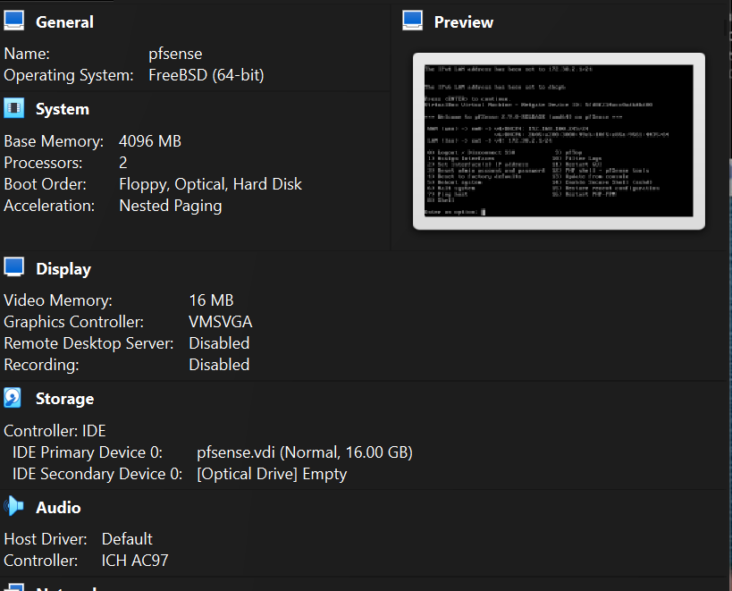

*Figure 1 — pfSense VM specifications and VirtualBox overview. Original document image49.png. pfSense VM, FreeBSD (64-bit), 4096 MB RAM, two processors, 16 GB virtual disk.*

The interface console then shows **pfSense 2.9.0-RELEASE** with a DHCP WAN address and configured LAN gateway. This provides the base for routing between the management-side subnet and the internal test network.

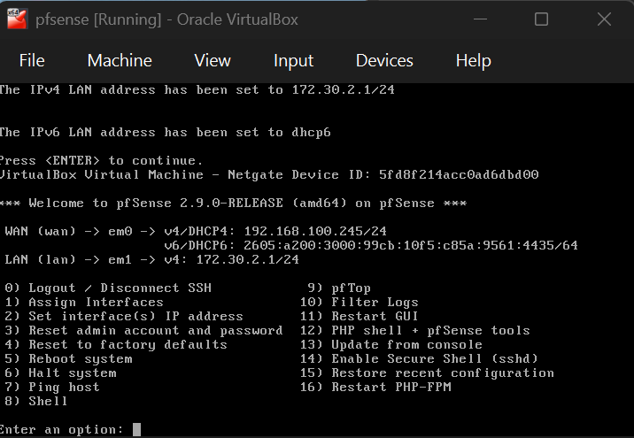

*Figure 2 — pfSense 2.9.0 console and WAN/LAN addressing. Original document image50.png. WAN em0 192.168.100.245/24 via DHCP; LAN em1 172.30.2.1/24.*

**What the interface names mean:**

- `em0` — WAN-facing adapter. pfSense obtained `192.168.100.245/24` from DHCP in this screenshot.
- `em1` — LAN-facing adapter. The LAN gateway is `172.30.2.1/24`.
- `/24` — a subnet mask of `255.255.255.0`; the first 24 bits identify the local network.

A console assignment verifies what pfSense believes its interfaces and IP addresses are; it does not by itself prove traffic can pass through every firewall or NAT rule.

### 2. Connect the VirtualBox adapters to the internal lab

The pfSense and Kali VM settings show a VirtualBox **Internal Network** named `pfVulnlab1`. Matching internal-network names allows attached adapters to share the same virtual Layer 2 network. The screenshot captures one adapter setting on each VM, not a complete view of every adapter on that machine.

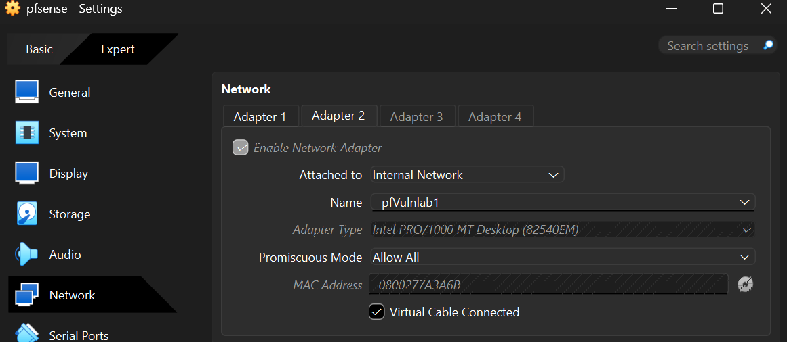

*Figure 3 — pfSense VirtualBox internal network adapter. Original document image51.png. Adapter shown attached to Internal Network named pfVulnlab1; capture shows one adapter setting.*

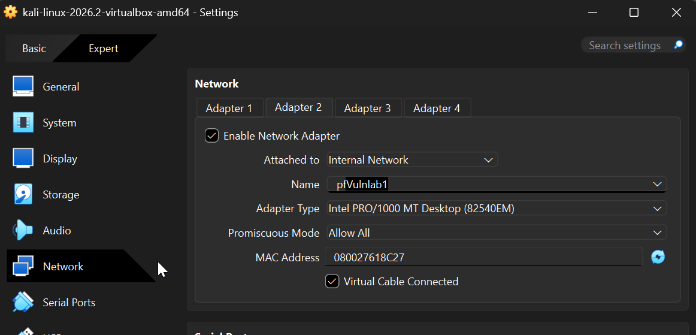

*Figure 4 — Kali Linux VirtualBox internal network adapter. Original document image52.png. Kali adapter attached to the same named internal network pfVulnlab1.*

**Why this matters:** a mismatch in the VirtualBox network name can leave two VMs with apparently correct IP addresses that cannot reach each other. Promiscuous mode is displayed as **Allow All** in these settings; it may be useful for packet-monitoring exercises, but should not be enabled without a need in production environments.

### 3. Inspect Kali Linux interface assignments

On Kali, the captured command was:

```bash
ip address
```

`ip address` displays interfaces, assigned IPv4/IPv6 addresses, and link state. In the screenshot, `eth0` is on `192.168.100.0/24` and `eth1` is on `172.30.2.0/24`.

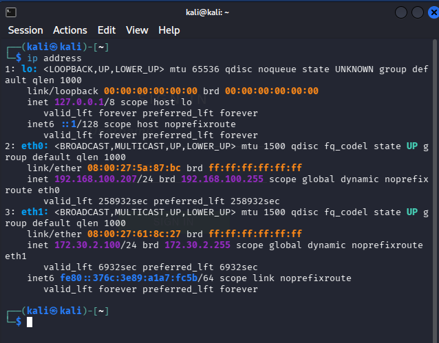

*Figure 5 — Kali Linux IP addresses and interfaces. Original document image53.png. ip address output: eth0 192.168.100.207/24 and eth1 172.30.2.100/24.*

**Result:** Kali has two visible interfaces and can participate in separate networks. Its `eth1` address (`172.30.2.100`) is in the same `/24` subnet as the pfSense LAN gateway (`172.30.2.1`). This makes it a suitable client for checking internal segmentation and gateway behavior.

### 4. Access the pfSense web interface and configure system settings

I opened the pfSense browser-based administration interface and proceeded through the general-setup options. This workflow provides the GUI for managing routing, firewall policies, DNS settings, and add-on packages.

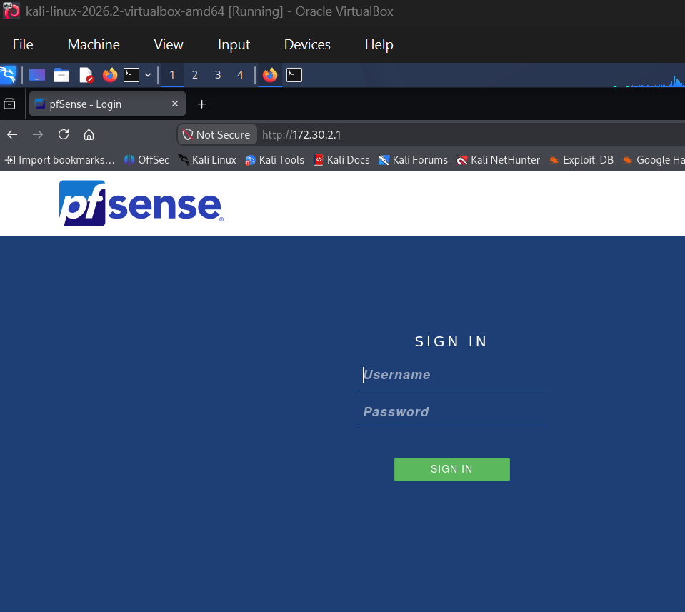

*Figure 6 — pfSense web management sign-in. Original document image54.png. Browser shows pfSense web configuration interface sign-in.*

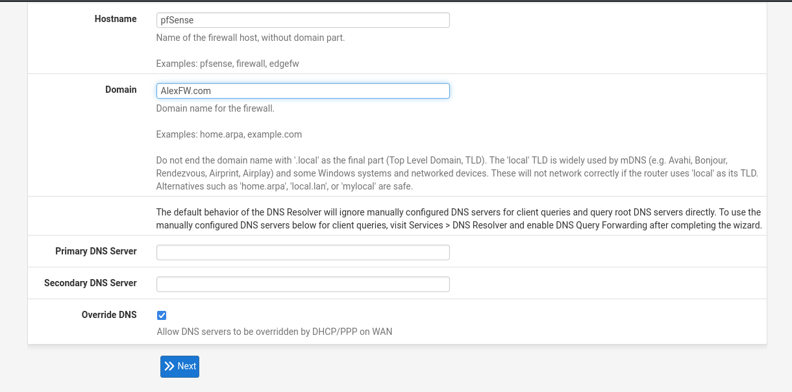

*Figure 7 — pfSense General Setup DNS/domain configuration. Original document image55.png. Hostname and domain settings from pfSense setup flow.*

The general-setup screenshot shows fields for the hostname, domain, and primary/secondary DNS servers. Those values affect how the firewall identifies itself and resolves hostnames, but a completed form alone is not proof that all DNS settings are working from the client VMs.

### 5. Configure and inspect LAN firewall rules

Within **Firewall → Rules → LAN**, I worked with rule action, protocol, source, and destination settings.

The rule-editor screenshot shows a **Block** action on the **LAN** interface, address family **IPv4**, and protocol **Any**. The following screen shows a source selection of **LAN subnets** with destination set to **Any**.

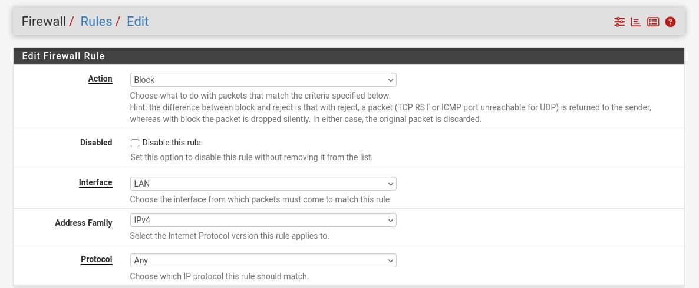

*Figure 8 — LAN firewall rule: Block action. Original document image56.png. Firewall > Rules > Edit displays Block, LAN interface, IPv4 and Any protocol.*

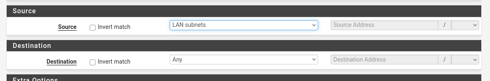

*Figure 9 — LAN firewall rule source/destination settings. Original document image57.png. Source LAN subnets and destination Any in the displayed form.*

**How pfSense filtering works:**

- **Action** determines whether a matching connection is passed, blocked, or rejected.
- **Interface** is where traffic entering pfSense is evaluated. LAN rules generally apply to traffic arriving on LAN.
- **Source/destination** determine the networks or hosts that match the rule.
- **Protocol/ports** narrow the traffic match; **Any** is broad and should be used carefully.
- **Rule order matters:** pfSense evaluates ordered rules and applies the first matching rule.

The resulting LAN rules page shows the rules together, including default entries. The screenshot documents policy setup and rule placement; it does not alone prove that a particular flow was blocked.

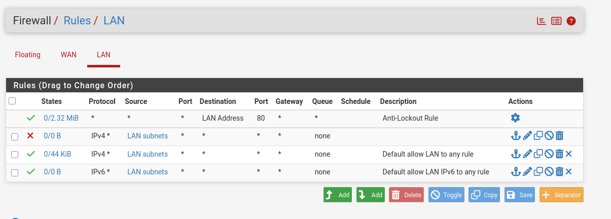

*Figure 10 — pfSense ordered LAN firewall rules. Original document image58.png. Existing LAN rules and order in the pfSense interface.*

### 6. Check reachability from the lab target

The Metasploitable terminal screenshot includes this test:

```bash
ping 8.8.8.8
```

`ping` sends ICMP Echo Requests. Replies from `8.8.8.8` provide evidence that the VM had outbound IP connectivity for this test. They do **not**, on their own, validate DNS name resolution, all client firewall rules, or persistent internet access.

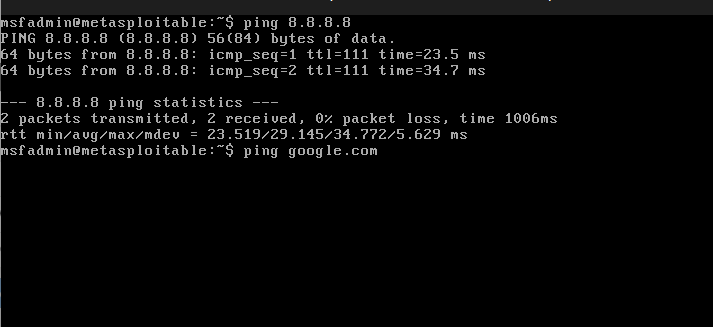

*Figure 11 — Metasploitable 2 outbound network connectivity test. Original document image59.png. ping 8.8.8.8 receives replies in the displayed test.*

### 7. Configure a controlled NAT port-forward

I reviewed **Firewall → NAT → Port Forward** and configured a translation targeting the internal address **`172.30.2.102`**. The destination for the configured rule is the pfSense **WAN address**.

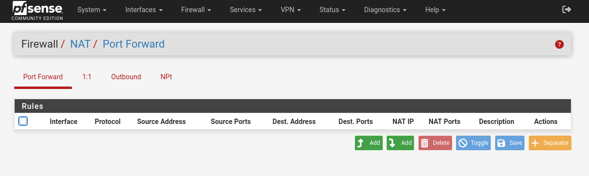

*Figure 12 — pfSense NAT port forwarding interface. Original document image60.png. Firewall > NAT > Port Forward initial rules view.*

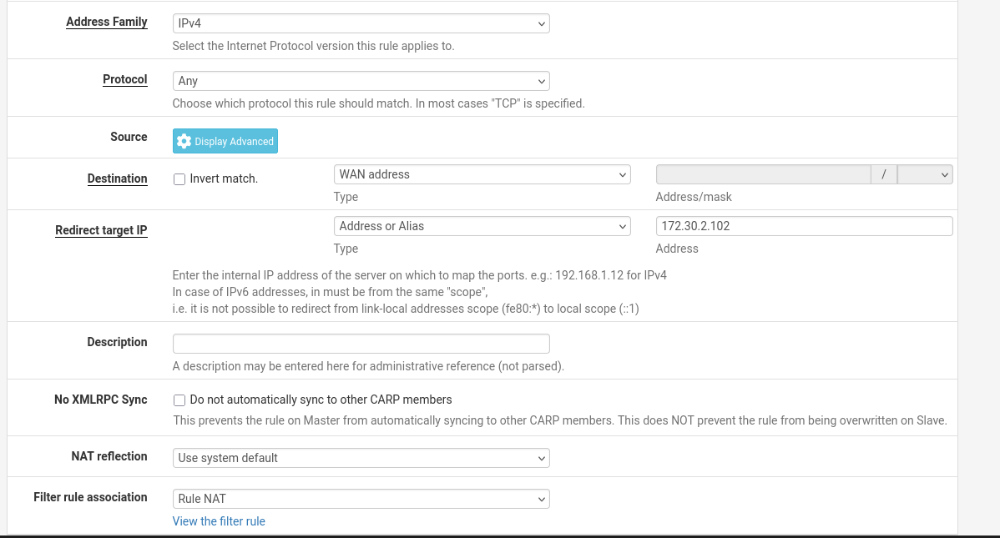

*Figure 13 — NAT redirect target configuration. Original document image61.png. WAN address redirect target IP 172.30.2.102; screenshot shows rule editing values.*

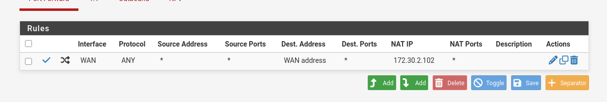

*Figure 14 — Saved NAT port-forward rule. Original document image62.png. NAT table lists the WAN rule with target 172.30.2.102.*

**What a port forward does:**

1. A client initiates a connection to a service exposed on the firewall's WAN address.
2. pfSense matches the connection against a port-forward rule.
3. pfSense rewrites the packet's destination address to a specific internal target.
4. The client may reach the internal service if the corresponding firewall rule and routing permit it.

The saved rule screenshot shows the internal target. The separate PuTTY test below is more meaningful validation than the saved rule alone.

> **Configuration review:** One editor screenshot displays **Protocol: Any** while the demonstrated use case is SSH. A production design should normally restrict the rule to the necessary protocol (TCP), destination port (22), and authorized sources. Keep this access scoped to an isolated test lab.

### 8. Validate SSH access through pfSense using PuTTY

PuTTY was configured to connect to **`192.168.100.245`** using **SSH on port 22**. This is the pfSense WAN address, not the internal target address.

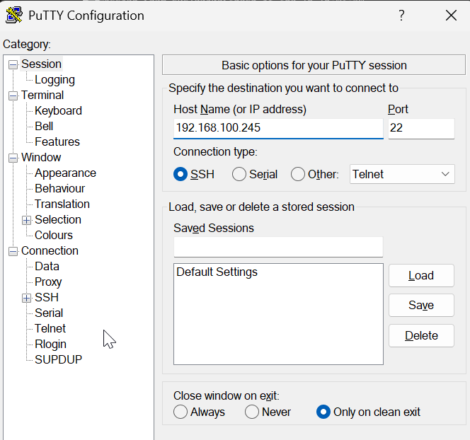

*Figure 15 — PuTTY SSH session configuration. Original document image63.png. PuTTY configured to contact 192.168.100.245 on TCP port 22.*

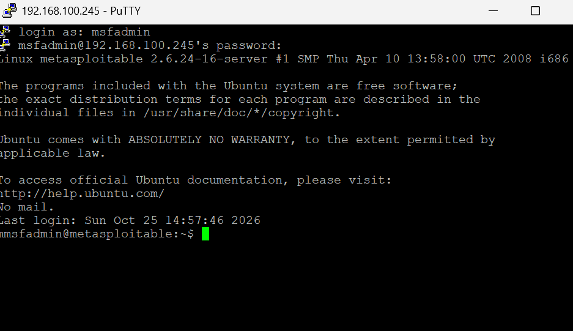

*Figure 16 — SSH session observed via PuTTY. Original document image64.png. Login through pfSense WAN address reaches the Metasploitable test machine.*

The connection output reaches the **Metasploitable** Linux environment (`msfadmin@metasploitable`). In context, this is evidence consistent with the NAT forwarding the WAN connection to the internal SSH service.

**What this test demonstrates:** a client was able to initiate an SSH session to the firewall-facing address and reach the internal target. It does **not** mean the firewall itself authenticated the Metasploitable user. pfSense is handling forwarding; the SSH service is on the destination host.

An equivalent *verification* command, where OpenSSH is available, is:

```bash
ssh -p 22 msfadmin@192.168.100.245
```

This command is provided as an equivalent to the demonstrated PuTTY test; the screenshot shows **PuTTY**, not this shell command.

### 9. Install the Snort package inside pfSense

For visibility into traffic passing through the firewall, I used the **Snort add-on package** in pfSense. The screenshot shows its entry under **System → Package Manager → Available Packages**. Subsequent screens show Snort configured and running inside pfSense.

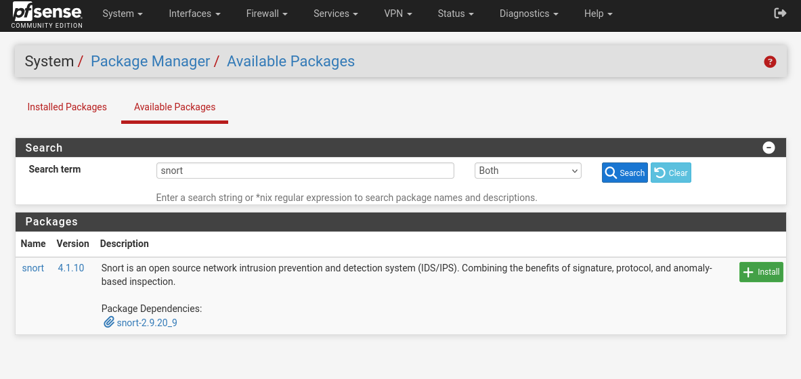

*Figure 17 — Snort package in pfSense Package Manager. Original document image65.png. pfSense Package Manager screen for the Snort add-on.*

This is **Snort integrated with pfSense**, separate from the standalone Ubuntu Snort IDS project documented elsewhere in my portfolio.

### 10. Write custom Snort rules to detect ICMP and SSH

The pfSense **Services → Snort → LAN Rules** screenshot contains **two custom signatures**, stored in the `custom.rules` category:

```snort
alert icmp any any -> $HOME_NET any (msg:"Ping Detected"; sid:1000001; rev:1;)
alert tcp any any -> $HOME_NET 22 (msg:"SSH Detected"; sid:1000002; rev:1;)
```

The repository also includes these in [`rules/pfSense-snort-custom.rules`](rules/pfSense-snort-custom.rules). The rules were transcribed from the screenshot and formatted with conventional final option semicolons; the detection logic and message text are unchanged.

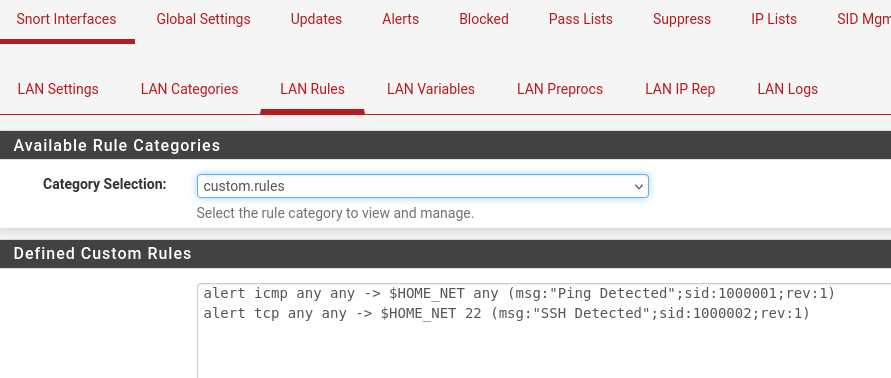

*Figure 18 — Custom pfSense Snort ICMP and SSH rules. Original document image66.png. custom.rules includes SID 1000001 Ping Detected and SID 1000002 SSH Detected.*

#### Understanding the rule syntax

| Rule component | Meaning |
|---|---|
| `alert` | Produce an IDS event when the rule matches |
| `icmp` / `tcp` | Layer 3/4 protocol to inspect |
| `any any` | Any source address and, for TCP, any source port |
| `->` | Match traffic going toward the destination |
| `$HOME_NET` | The home/protected network variable configured for this Snort interface |
| `any` / `22` | Any destination port for ICMP or TCP destination port 22 for SSH |
| `msg` | Human-readable alert description |
| `sid` | Unique signature identifier used to associate rules with events |
| `rev` | Revision of the custom signature |

**Rules and expected outcome:** `1000001` detects ICMP messages toward `$HOME_NET`; `1000002` detects TCP packets destined for port 22 within `$HOME_NET`. The latter detects **traffic to SSH**, not necessarily an SSH brute-force attempt or successful login.

### 11. Confirm Snort is attached to the LAN interface

The Snort interface page identifies **LAN (`em1`)** as the monitored interface and shows the detection service running. At this stage, the **Blocking Mode** column reads **DISABLED**.

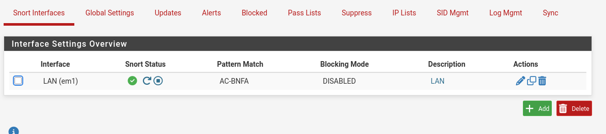

*Figure 19 — pfSense Snort LAN interface and blocking state. Original document image67.png. LAN (em1) active, pattern match AC-BNFA; blocking mode shown disabled at this stage.*

**Interpretation:** these settings can support **intrusion detection and alerting**. A working alert is not the same thing as preventing the packet from reaching its destination. Later blocking-specific settings and the blocked-host list are covered separately.

### 12. Validate the ICMP detection signature

The **Snort Alerts** screen records **Ping Detected** events. In the displayed results, the signature appears as `1:1000001`, linking the logged events to the custom ICMP rule. Source/destination IP columns provide context for the matching flows.

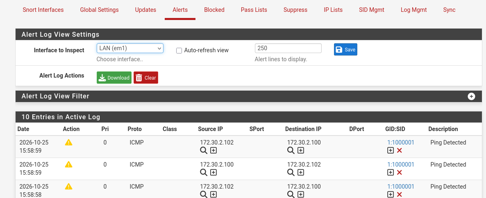

*Figure 20 — pfSense Snort initial ICMP alerts. Original document image68.png. Alert log shows custom Ping Detected events with SID 1:1000001.*

**What the result proves:** Snort generated events for ICMP traffic matching the configured signature. This is positive evidence that the rule was loaded and that traffic reached the monitored interface.

### 13. Exercise the SSH rule and inspect matching alerts

A second PuTTY screenshot captures another SSH connection test to the pfSense WAN address. The following Snort Alerts screen shows **SSH Detected** entries with signature `1:1000002`, consistent with the custom port-22 rule.

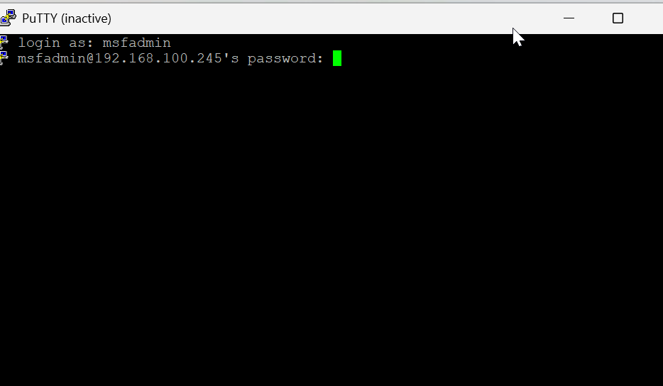

*Figure 21 — PuTTY SSH authentication test. Original document image69.png. PuTTY SSH login prompt against 192.168.100.245 during testing.*

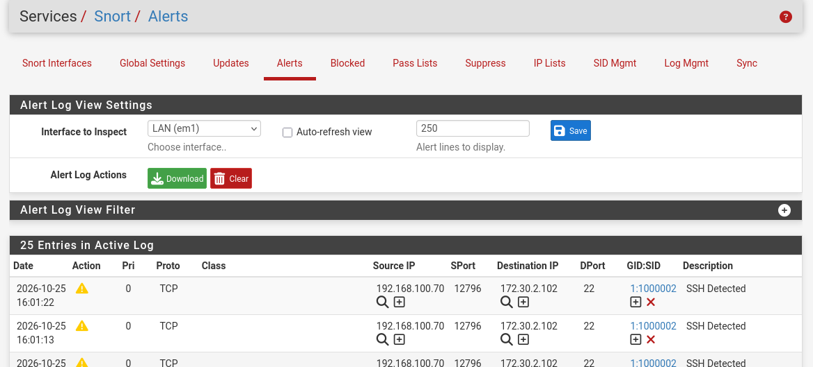

*Figure 22 — pfSense Snort SSH detection events. Original document image70.png. Snort alert log shows SSH Detected entries associated with SID 1:1000002.*

The rule is intentionally broad: it matches TCP traffic toward destination port 22 on the protected network. Its alerts should be interpreted as **SSH-related connection activity**, not as proof of malicious access or credential compromise.

### 14. Review blocking configuration and Windows-side reachability

The Snort **Block Settings** screenshot shows controls for `Block Offenders`, `IPS Mode` (Legacy Mode), `Kill States`, and which IP address to block. This appears later in the source sequence than the interface status screenshot that displayed blocking as disabled.

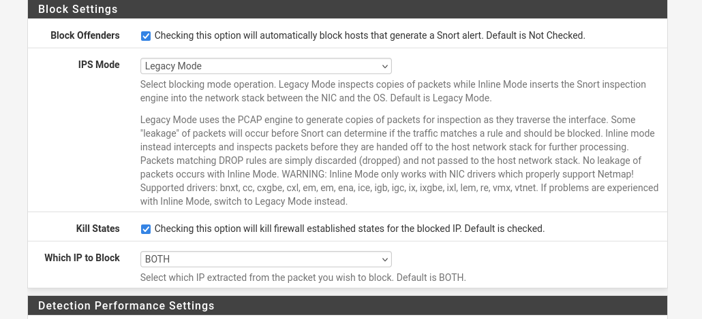

*Figure 23 — pfSense Snort block settings. Original document image71.png. Block Offenders, IPS Mode, Kill States and Which IP to Block settings screenshot.*

From Windows, I tested reachability of the pfSense WAN address:

```powershell
ping 192.168.100.245
```

The Command Prompt screenshot contains successful replies **and one Request timed out**. That mixed result demonstrates the response of this particular test at the captured moment; a single timeout does not, on its own, prove why a packet failed or establish that Snort was the cause.

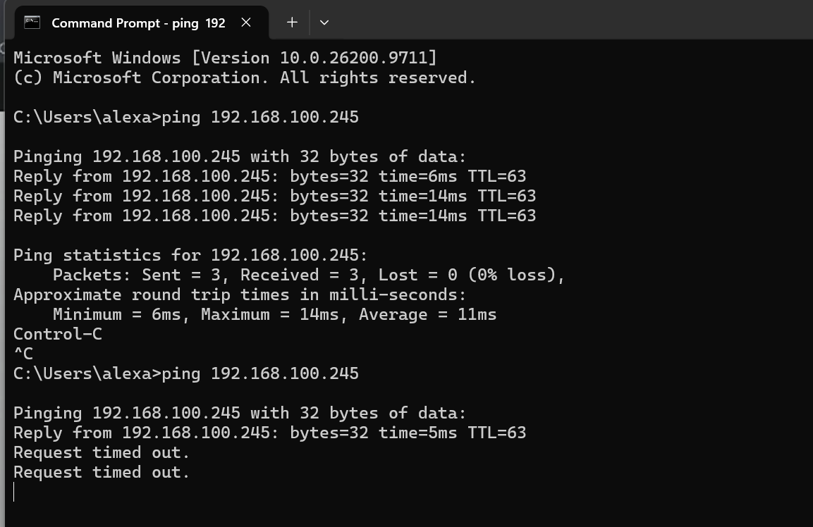

*Figure 24 — Windows host ping test against pfSense WAN. Original document image72.png. ping 192.168.100.245 displays responses and one request timed out.*

### 15. Examine accumulated Snort alerts and blocked-host evidence

The later alert-view screenshot shows **91 entries in the active log** and sample events labeled **Ping Detected**. This shows the interface retained a history of matching packets beyond the initial proof-of-concept alerts.

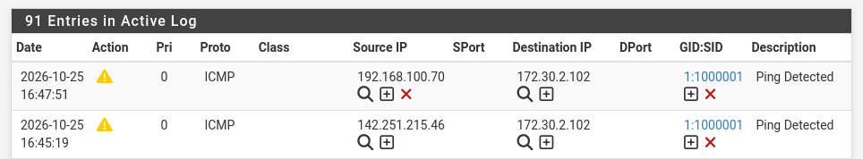

*Figure 25 — pfSense Snort active-alert log. Original document image73.png. Log summary with 91 entries and sample Ping Detected events.*

The **Blocked** view separately lists **`192.168.100.70`** as a blocked host, with event descriptions associated with **Ping Detected** and **SSH Detected** signatures. The screenshot demonstrates that the host appears in Snort's blocking list; it does not establish when every associated packet was dropped or whether the block remained in force after the screenshot.

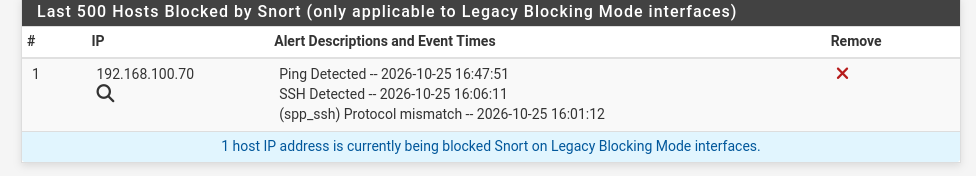

*Figure 26 — Snort blocked hosts view. Original document image74.png. Blocked-hosts panel shows a host entry for 192.168.100.70.*

A related **IP/alias settings** screenshot includes `192.168.100.70`. pfSense aliases help organize IPs/networks for rules or Snort list configuration. Because the screenshot is a form, it does not independently prove which pass-list or firewall policy ultimately consumed that alias.

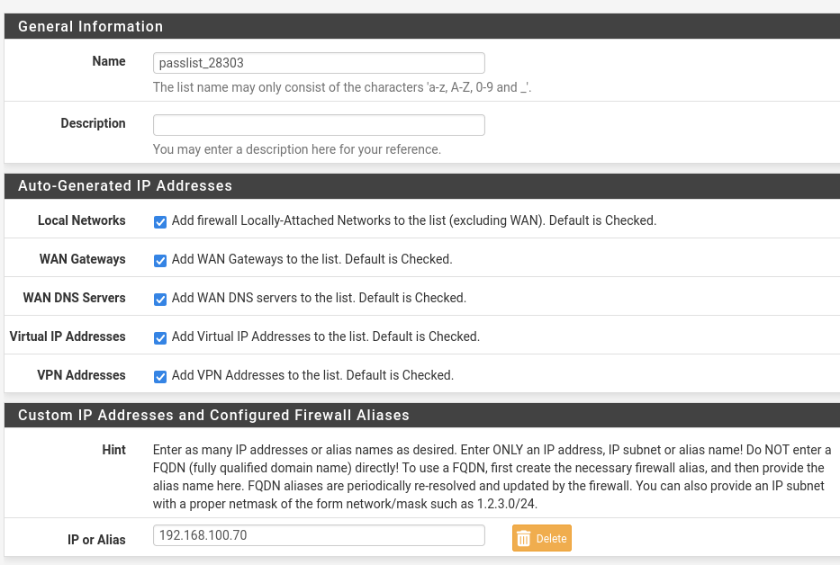

*Figure 27 — pfSense alias/pass-list-related configuration. Original document image75.png. General Information with custom alias IP 192.168.100.70.*

### 16. Additional pfSense interface rules from another lab stage

The source document contains another pfSense firewall screenshot under the **OPT1** interface with source `172.60.1.0/24`.

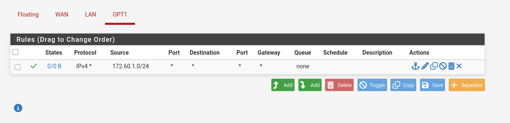

*Figure 33 — Additional pfSense OPT1 firewall rule (separate stage). Original document image81.png. OPT1 rule with 172.60.1.0/24 source, distinct from 172.30.2.0/24 testing segment.*

This shows that the larger home lab also experimented with **additional interfaces and subnets**. I document it as separate evidence rather than changing the 172.30.2.0/24 topology to include a connection that the screenshots do not prove.

---

## Findings and validation summary

| Control or test | Evidence | Defensible finding |
|---|---|---|
| pfSense virtual firewall | VM settings + console | pfSense 2.9.0 lab VM running with WAN/LAN IP assignments |
| Internal virtual networking | VirtualBox adapter settings | pfSense and Kali attached to an identically named internal network |
| Endpoint network configuration | Kali `ip address` | External-side and internal-side addresses visible |
| Firewall policies | LAN rule editor and table | Block rule configured/viewed and rule ordering inspected |
| IP reachability | Metasploitable ping | Test target received ICMP replies from `8.8.8.8` |
| NAT / translated SSH | Port-forward views + PuTTY | SSH session reached the internal Metasploitable environment via the WAN IP |
| Snort deployment | Package manager + interface list | Snort configured on pfSense LAN |
| ICMP signature | `custom.rules` + ICMP alerts | SID `1000001` generated Ping Detected entries |
| SSH signature | `custom.rules` + SSH alerts | SID `1000002` generated SSH Detected entries |
| Block settings | Settings screen + Blocked page | Blocking controls reviewed and blocked host shown; earlier state was disabled |
| Additional network segment | OPT1 firewall rule | Separate 172.60.1.0/24 interface rule appears in another stage |

## Challenges and lessons learned

1. **Network segmentation can be easy to misconfigure.** Both virtual adapter names and IP subnet membership must align for expected connectivity.
2. **Saving a NAT rule is not enough.** Testing the actual forwarded service (here, SSH in PuTTY) provides evidence that destination translation and the reachable service are functioning.
3. **Firewall policy and IDS policy are different layers.** A pfSense firewall rule decides whether packets may pass; a Snort alert reports a rule match. A block setting is needed for prevention behavior.
4. **Signature IDs make alerts auditable.** A visible `sid` in `custom.rules` can be linked to a specific log entry instead of relying only on the alert's message text.
5. **Broad matches are useful for lab demonstrations but noisy for real networks.** The ICMP and SSH signatures detect common traffic, not automatically malicious behavior. They require tuning and context before production use.
6. **Screenshots are point-in-time evidence.** The disabled blocking mode, later blocking configuration, and different OPT1 subnet are recorded as stages rather than rewritten into a single unverified final state.

## Recommended next improvements

- Replace any wide-open NAT setting with **TCP/22 limited to known test sources**.
- Use separate virtual networks for vulnerable targets and day-to-day host traffic.
- Record a simple before-and-after test for each firewall action, including the rule ID and test result.
- Define and document the exact `$HOME_NET` Snort value for the LAN interface.
- Tune ICMP/SSH rules to reduce false positives and document what distinguishes legitimate use from attacks.
- If testing Snort prevention, capture a controlled **blocked-versus-allowed** result with matching timestamps and destination evidence.

## Evidence inventory

- **28 original pfSense-related screenshots** are embedded throughout this README (source images 49–75 plus 81).
- Every image is saved under [`screenshots/`](screenshots/).
- See [`SCREENSHOT-GUIDE.md`](SCREENSHOT-GUIDE.md) for the exact mapping between original image numbers, filenames, and explanations.
- See [`rules/pfSense-snort-custom.rules`](rules/pfSense-snort-custom.rules) for a reusable transcription of the custom pfSense Snort signatures.

## Conclusion

This home-lab exercise combines **pfSense firewall administration**, **subnet configuration**, **firewall rules**, **destination NAT**, and **Snort intrusion detection** in a controlled virtual environment. The strongest evidence is the translated SSH connection through the pfSense WAN address and the custom Snort rules generating identifiable ICMP/SSH alerts. The lab strengthened my understanding of how access controls and detection systems work together, and how to validate security configurations with reproducible tests.

---

**Author:** Alexander Cox  
[GitHub Portfolio](https://github.com/KerberosAC) · [LinkedIn](https://www.linkedin.com/in/alexandercox25/)

**Responsible use:** All described tests were performed as part of a controlled educational lab. Do not expose vulnerable practice systems publicly or replicate broad forwarding rules in a production network.
